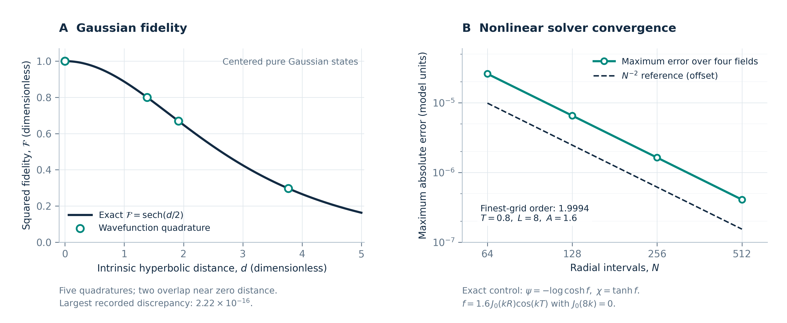

# On Quantum Mechanics and General Relativity

**Logan Voss** · Research edition 1.0 · November 13, 2026

### An exact meeting point between quantum uncertainty and gravitational geometry

Imagine writing a rulebook for gravity while leaving its coefficients unknown. Instead of guessing their form, ask a demanding question: **can empty, flat spacetime remain a solution when geometry, area, and shape are all varied independently?**

Within the local model studied here, that question has an exact answer. Four unknown functions collapse to one affine family. The resulting bulk action is precisely the symmetry-reduced Einstein action. And the shape space it uses is also the space of centered quantum states that saturate the uncertainty bound.

**The result is a conditional mathematical bridge:** quantum phase-space geometry and gravitational orbit geometry fit together exactly in a specified two-symmetry model. Its assumptions, proofs, computations, and remaining research questions are all open to inspection here.

[Read the paper](paper/On_Quantum_Mechanics_and_General_Relativity.pdf) · [Understand the theorem](docs/MODEL_AND_THEOREM.md) · [Check the evidence](docs/VERIFICATION.md) · [Reproduce it](docs/REPRODUCIBILITY.md)

## The central result

Space is described by a Lorentzian base metric $h$, a positive area $\rho$, and a positive symmetric shape matrix $M$ with $\det M=1$:

```math
ds^2=h_{ab} dx^a dx^b+\rho M_{IJ} dy^I dy^J.
```

In the stated invariant, local action class with total derivative order at most two, full stationarity of one flat reference chart selects

```math
\boxed{F(\rho)=a\rho+b,\qquad U(\rho)=\frac{a}{2\rho},\qquad W(\rho)=a\rho,\qquad V(\rho)=0.}
```

Positive, nondegenerate shape energy gives $a>0$. A permitted parity-odd coupling becomes constant and contributes only at the boundary under the stated conditions. The magnitude of $a$ and the bulk-inert constants remain free.

Here **stationarity** means that the first variation vanishes for every compactly supported change of all independent fields. It does not assert that every disturbance remains small for all time. The [full theorem](docs/MODEL_AND_THEOREM.md) gives the theory class and both directions of the proof.

## Where quantum mechanics enters

A centered canonical state saturating the Robertson–Schrödinger covariance uncertainty bound is a pure Gaussian. Its covariance $\Sigma$ determines

```math
M=2\Sigma=\frac1v
\begin{pmatrix}1&u\\u&u^2+v^2\end{pmatrix},\qquad v>0,
```

in calibrated dimensionless units with $[\widehat Q,\widehat P]=i$. With the specified common frame representation, this is exactly the gravitational orbit-shape matrix. Its geometry obeys

```math
\boxed{ds_G^2=\frac12\mathrm{Tr}\left[(M^{-1}dM)^2\right]
=\frac{du^2+dv^2}{v^2}=2 ds_{\mathrm{QFI}}^2.}
```

This identifies the shape geometry exactly. The Lorentzian base, field content, and physical identification of probe frames with orbit frames are explicit inputs.

## Four additions in this edition

**Distance becomes quantum overlap.** For any two states in the centered saturated family, their squared overlap is fixed by the intrinsic hyperbolic shape distance:

```math
\boxed{\left|\langle\psi_M\mid\psi_N\rangle\right|^2
=\mathrm{sech}\left(\frac{d_G(M,N)}2\right).}
```

**The boundary term has a geometric-phase interpretation.** The real and imaginary parts of the same quantum geometric tensor supply the shape metric and its area form. With $\mathcal A=i\langle\psi|d\psi\rangle$,

```math
\boxed{\mathcal F_{\mathrm B}=d\mathcal A=-\frac14\Omega,
\qquad S_{\mathrm{odd}}=-8k\oint_{\partial B}q^*\mathcal A.}
```

Here $q$ maps the base into the shape space. Both results are proved in [Quantum geometry](docs/QUANTUM_GEOMETRY.md), with the established Gaussian-state literature credited.

**The selection has explicit error bars.** Small residuals in five calibrated field-equation components force quantitative bounds on all four coefficient functions, including an integrated bound on departure from an affine law. [Proof and sharp constants](docs/ROBUST_SELECTION.md).

**The solver meets an exact nonlinear solution.** A hyperbolic-target geodesic turns a Bessel wave into an exact two-field solution. The numerical implementation converges to it at second order. [Verification and data](docs/VERIFICATION.md).



## What has been checked

| Evidence | Result |
|---|---|
| Original formal proof | 40 Lean theorems across 7 modules; rebuilt with zero warnings and zero errors |
| Expanded formal proof | 48 theorems across 8 modules, including the new residual identities and bounds; zero warnings and zero errors |
| Original symbolic calculations | 373 exact checks and 256 additional rational current-jet cases passed |
| Original nonlinear benchmark | 7 fresh evolutions; approximately second-order convergence |
| New quantum geometry and residual checks | 58 exact checks and 5 direct wavefunction quadratures passed |
| New solver controls | Exact linear and nonlinear oracles; separate timestep refinement |

The [formal inventory](docs/FORMAL_PROOFS.md) also lists this edition's additional residual certificates. Axioms, theorem assumptions, commands, source hashes, raw states, tolerances, and logs are retained. The [evidence guide](docs/VERIFICATION.md) distinguishes written proofs, Lean certificates, symbolic identities, and numerical observations.

## Explore and reproduce

```bash
python3 -m venv .venv
source .venv/bin/activate
python -m pip install -r requirements.txt
python scripts/check_bundle.py
python scripts/reproduce.py --output-dir work/reproduction
```

Lean uses the pinned **4.19.0** toolchain and exact mathlib revision. See [reproduction instructions](docs/REPRODUCIBILITY.md) for the formal build and [GitHub Actions](https://github.com/LoganVoss/on-quantum-mechanics-and-general-relativity/actions) for remote executions.

The [paper](paper/On_Quantum_Mechanics_and_General_Relativity.pdf) brings the argument together. The [original v2.4 supplement](source/v2.4/paper/Voss_Chart_Selection_Proof_v2_4.pdf) preserves the detailed variation, integrability, physical-model witnesses, and deformation analysis. [Provenance](docs/PROVENANCE.md) tracks the recovered earlier archive. [Related work](docs/RELATED_WORK.md) places the results in context.

## What this opens up

This bundle supplies an exact, reproducible meeting point between quantum-state geometry and a nonlinear gravitational model, plus tools for testing departures from its selected law. It provides a foundation for sharper calibration tests and a controlled study of quantization.

An interacting quantum continuum, operational quantum-gravitational measurements, and extensions beyond the two-symmetry sector remain research problems. The simulations are synthetic, and no experimental confirmation or worldwide priority is claimed. The [research roadmap](docs/RESEARCH_ROADMAP.md) gives concrete next tests.

Research by **Logan Voss**, with AI-assisted mathematical development, independent computational checks, formalization, and editing. See [citation metadata](CITATION.cff), [contribution guidance](CONTRIBUTING.md), and the [rights notice](LICENSE-NOTICE.md).
