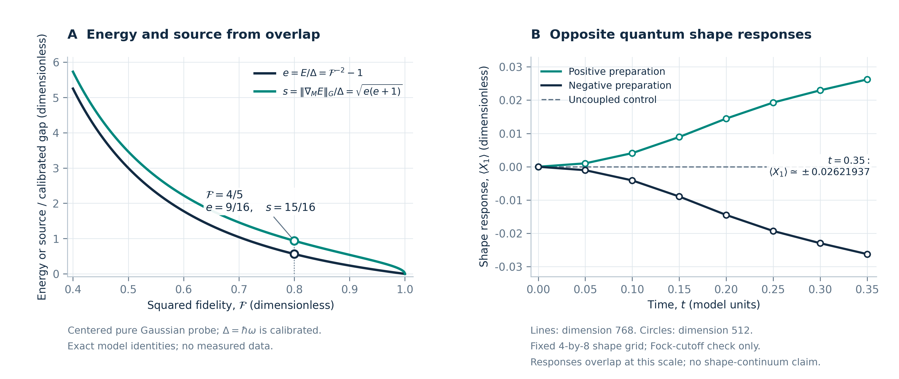

# On Quantum Mechanics and General Relativity

**Logan Voss** · Research edition 2.0 · November 13, 2026

### From quantum-state geometry to reciprocal dynamics

A quantum state has a measurable shape: the sizes and correlations of its uncertainties. The original result connected that shape to a restricted gravitational geometry and selected the reduced Einstein action from flat-space consistency.

This edition takes three further steps. It selects a quantum probe interaction that can push back on shape, distinguishes the stated curvature-squared alternatives through calibrated matter responses, and extends the action-selection argument to a spacetime with only **one required Killing symmetry**.

These are exact conditional results, supported by written proofs, formal certificates, symbolic calculations, and bounded quantum simulations. The assumptions that select each result are stated alongside it.

[Read the extension paper](paper/On_Quantum_Mechanics_and_General_Relativity_Dynamical_Extensions.pdf) · [Read the foundation paper](paper/On_Quantum_Mechanics_and_General_Relativity.pdf) · [Verify the results](docs/VERIFICATION.md) · [Reproduce everything](docs/REPRODUCIBILITY.md)

## A compact energy–shape equation

For the selected oscillator probe, the excitation energy is determined by its overlap with the locally matched Gaussian ground state:

```math
\boxed{\Delta E=\hbar\omega\left(\mathcal F^{-2}-1\right),
\qquad \mathcal F=|\langle\psi_M|\psi_N\rangle|^2.}
```

Here $M$ is the calibrated geometric target, $N$ is the covariance shape of an independently prepared centered pure Gaussian probe, and $\hbar\omega$ is the calibrated oscillator gap. The overlap $\mathcal F$ is a transition probability. This equation measures excitation above the matched ground state.

The same interaction fixes the geometric source $\mathcal S=-\nabla_M\Delta E$ for this state–target pair:

```math
\boxed{\|\mathcal S\|_G^2=\Delta E(\Delta E+\hbar\omega).}
```

For example, $\mathcal F=4/5$ gives an excitation energy of $9\hbar\omega/16$ and source magnitude $15\hbar\omega/16$. The [energy–shape guide](docs/ENERGY_SHAPE_RELATION.md) derives these relations, gives energy-budget and calibration applications, and explains the uncertainty correction outside the saturated family.

```bash
python examples/energy_shape.py --fidelity 0.8
```

## What selects the interaction?

Require the probe Hamiltonian to be instantaneous, algebraic, target-only, centered, quadratic, positive after vacuum calibration, and covariant under the same $SL(2,\mathbb R)$ frame changes as the shape matrix. Derivative, background, and extra-field dependence are excluded in this class. These requirements fix its form:

```math
\boxed{\widehat H_M^{\mathrm{ex}}
=\frac{\hbar\omega}{2}\widehat R^T M^{-1}\widehat R
-\frac{\hbar\omega}{2}I.}
```

Its ground state has covariance $M/2$. The Hamiltonian is selected before solving the trajectory. In the one-Killing target-only class, the remaining frequency is a constant calibration; in the original model an independent area variable would permit additional area dependence unless constrained.

Quantizing the shape degree of freedom gives a positive joint Hamiltonian on the shape–probe Hilbert space. It evolves by ordinary linear quantum mechanics and produces reciprocal response and entanglement. Two symmetry-related preparations can have identical **full joint-energy distributions** yet opposite initial shape responses, measured with a bounded local observable. The finite-regulator computations reproduce this directional distinction.

[Selected coupling, proof, and controls](docs/DYNAMICAL_COUPLING.md)

## A wider gravitational sector

The extension uses a three-dimensional quotient and one spacelike Killing field:

```math
 g_4=\lambda^{-1}h_{ab}dx^a dx^b
 +\lambda(dy+A_a dx^a)^2,\qquad \lambda>0.
```

The target variables are now the Killing norm $\lambda$ and twist potential $\chi$. Their metric is

```math
G=\frac{d\lambda^2+d\chi^2}{\lambda^2}.
```

A flat spacetime described by a helical Killing field selects the relative curvature and target-kinetic coefficients in the full invariant two-derivative action:

```math
\boxed{S_3=a\int\sqrt{-h}\left[R[h]
-\frac{(\nabla\lambda)^2+(\nabla\chi)^2}{2\lambda^2}\right]d^3x.}
```

The resulting theory allows arbitrary dependence on **two quotient spatial coordinates**. The calibration itself is highly symmetric, but that extra symmetry is not imposed on the theory. Restricting further to the cylindrical sector recovers the earlier nonlinear equations exactly. The norm/twist quantum dictionary is explicitly distinguished from the original two-orbit shape dictionary.

[One-Killing theorem and full converse](docs/ONE_KILLING_EXTENSION.md)

## Distinguishing curvature-squared alternatives

Ricci-flat vacuum solutions alone leave many alternatives indistinguishable. In the unrestricted four-dimensional, constant-coefficient, parity-even quadratic class,

```math
S=\frac1{2\kappa}\int\sqrt{-g}
\left[R+\alpha R^2+\beta R_{ab}R^{ab}+\gamma E_4\right]d^4x+S_m,
```

requiring the specified **dust cosmology and charged electrovac geometry with their same calibrated sources** selects

```math
\boxed{\alpha=\beta=0,}
```

while the constant Euler coefficient remains locally invisible. The two residuals have an exact inverse with sharp error bounds. This strengthens the original vacuum test by adding explicit sourced calibration premises.

A complementary response calculation gives two measurable-in-principle transfer channels:

```math
r_2(z)=\frac1{1-\beta z},\qquad
r_0(z)=\frac1{1+(6\alpha+2\beta)z}.
```

Their inverse determines both coefficients in the declared class. Additional scales can estimate the gravitational normalization and test the class itself.

[Quadratic selection theorem](docs/QUADRATIC_SELECTION.md) · [Response and potential tomography](docs/RESPONSE_TOMOGRAPHY.md)

## The coupling must preserve reconstruction

A quantum source changes the twist equation. Keeping the vacuum reconstruction unchanged would be inconsistent. A covariant smooth-current variational model instead yields the corrected relation and its required contact interaction:

```math
 d\chi=\lambda^2\left(*F-\frac Ja\right),\qquad
 \mathcal L_{\mathrm{dual}}
 =-\frac{a\lambda^2}{4}\left(F+\frac{*J}{a}\right)^2.
```

The cross term and current-squared term follow from one master action. The same action supplies reciprocal field equations and cancelling stress-divergence identities. Smooth currents, the three-dimensional clock calibration, and the limits of a four-dimensional matter interpretation are explicit.

[Current, conservation, and reconstruction](docs/CURRENT_AND_RECONSTRUCTION.md)

## Evidence you can inspect



| Layer | What is included |
|---|---|
| Formal certificates | **63 Lean theorems across 9 modules; zero warnings and zero errors** |
| Exact extensions | Coupling and force identities; one-Killing curvature and converse; full quadratic response and sourced calibration; corrected twist duality |
| Independent controls | A separately implemented review, direct variation of the Ricci-squared action, exact ground-band kinetic and leakage calculations |
| Quantum dynamics | 512- and 768-dimensional positive regulators; cutoff comparison, conserved norm/energy, directional response, entanglement, uncoupled control |
| Foundation | The original proof, 373 symbolic checks, 256 rational current jets, seven nonlinear evolutions, and exact solver controls |

The Lean statements certify their explicit algebraic and calculus claims. Tensor variations, operator-domain arguments, and the physical interpretation have separate written and computational evidence. The [claim ledger](CLAIMS.json) and [formal inventory](docs/FORMAL_PROOFS.md) identify the boundaries.

```bash
python3.12 -m venv .venv
source .venv/bin/activate
python -m pip install -r requirements.txt
python scripts/check_bundle.py
python scripts/reproduce.py --output-dir work/reproduction
```

See [formal-build instructions](docs/REPRODUCIBILITY.md) and [GitHub Actions](https://github.com/LoganVoss/on-quantum-mechanics-and-general-relativity/actions). The [version 1.0 release](https://github.com/LoganVoss/on-quantum-mechanics-and-general-relativity/releases/tag/v1.0.0) preserves the foundation unchanged.

## What these results establish

The framework now has a selected reciprocal interaction, a broader sourced action discriminator, and a genuine one-Killing selection theorem. The ground-state geometry also determines a Berry connection, a scalar kinetic correction, and an exact initial excitation law when shape is quantized.

The quantum regulator and covariant state-fluid model are distinct constructions; a continuum limit connecting them has not been established. A general constrained quantum-gravity continuum, an ordinary minimally coupled four-dimensional matter uplift, and experimental confirmation remain open. Established Gaussian, reduced-gravity, and quadratic-gravity results are credited; worldwide priority is not asserted.

[Research roadmap](docs/RESEARCH_ROADMAP.md) · [Related work](docs/RELATED_WORK.md) · [Provenance](docs/PROVENANCE.md)

Research by **Logan Voss**, with AI-assisted derivation, verification, formalization, and editing. [Citation](CITATION.cff) · [Contributing](CONTRIBUTING.md) · [Rights notice](LICENSE-NOTICE.md)
