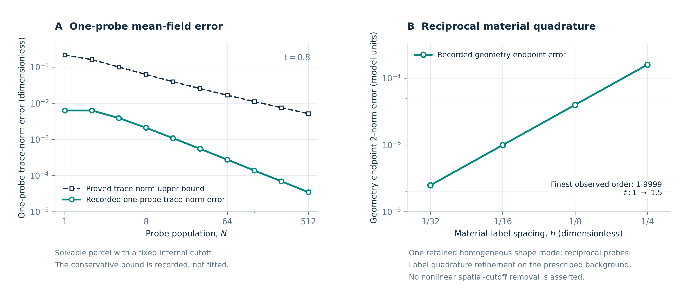

# On Quantum Mechanics and General Relativity

**Logan Voss** · Research edition 3.0 · November 13, 2026

### A controlled route from quantum probes to matter

How can a quantum model approach the fluid-like matter description used in the gravitational construction?

This edition gives a quantitative answer for an **explicitly augmented regulator**, before caustics, on a prescribed spacetime background and at **fixed geometric resolution**. Collective quantum probes form material parcels; their internal states remain quantum while the collective coordinates concentrate. The parcel continuum produces the covariant state-fluid matter action, with estimates strong enough to retain its current-squared contact term.

The full nonlinear geometric continuum remains open. The result here controls the **matter-sector connection** and separately proves a spatial-limit theorem in the linearized covariant sector.

[Read the continuum paper](paper/On_Quantum_Mechanics_and_General_Relativity_Controlled_Matter_Limits.pdf) · [Exact limit contract](docs/CONTINUUM_CONTRACT.md) · [Verification](docs/VERIFICATION.md) · [Reproduction](docs/REPRODUCIBILITY.md)

## The quantum estimate

For each fixed regulator specification, the deviation from the limiting parcel dynamics obeys

```math
\boxed{\mathfrak D_n(t)
\le e^{Ct}\left[\mathfrak D_n(0)+\frac{B^2t}{n^2}\right],
\qquad \mathfrak D_n(0)=O(n^{-1}).}
```

The constants are constructed from the actual Hamiltonian coefficients, mass gaps, preparations, and observable norms. They may grow when cutoffs change; the population is chosen after those constants are known.

The estimate also controls reduced quantum states:

```math
\|\rho_n^{(k)}-\rho^{\otimes k}\|_1
\le\sqrt{2kS_n},\qquad 1\le k\le n.
```

This supplies the pure internal-state closure needed by the matter model under the stated preparation conditions. It does not assert that the entire many-body state becomes a product.

[Quantum-to-parcel proof, explicit constants, and controls](docs/QUANTUM_TO_PARCELS.md)

## The proper clock is derived

The microscopic parcel uses a collective internal mass:

```math
H_n=n\sqrt{P_n^2+\left[m_0+A_n(\widehat H_M)\right]^2}.
```

Its limiting internal evolution is

```math
i\hbar\dot\psi=\frac{\varepsilon}{E}\widehat H_M\psi,
\qquad
\varepsilon=m_0+\langle\widehat H_M\rangle,\qquad
E=\sqrt{p^2+\varepsilon^2}.
```

Because $\dot X=p/E$, the multiplier is precisely $d\tau/dt$. The internal state therefore obeys the selected Schrödinger law in proper flow time. The exact Legendre transform gives the worldline integrand whose material-label continuum becomes the covariant matter action.

Physical positions, transport, and collective populations are **added microscopic structure**. They are not hidden in the earlier one-cell shape grid.

## The matter limit retains reciprocal response

The retained geometric modes respond to the parcels through the same Hamiltonian. A controlled midpoint estimate gives an $O(\ell^2)$ material-grid error on a regular interval. A strong quantum-current estimate then controls the term that weak convergence would miss:

```math
\delta_J\le C_T\left[
\eta^2+\ell^2\eta^{-3}
+\delta_{\mathrm{path}}\eta^{-2}
+\delta_{\mathrm{amp}}\eta^{-1}
+\frac{1}{N\ell^2\eta}\right].
```

Here $\ell$ is the two-dimensional material-label mesh and $\eta$ is the smoothing width. The errors include quantum fluctuations, approximation, and rounding effects.

One sufficient fixed-cutoff choice is

```math
\eta=\ell^{2/5},\qquad
N\ge A_\ell^2\ell^{-26/5},
```

with the coefficient-approximation error chosen appropriately first. It gives $O(\ell^{4/5})$ current and contact-functional convergence. All cutoff-dependent norms remain inside the explicitly specified constants; this is a conservative construction, not an efficiency claim.

[Material continuum and strong-current proof](docs/MATTER_CONTINUUM.md) · [Complete ordering of limits](docs/CONTINUUM_CONTRACT.md)



## A separate spatial continuum theorem

On an exact $2+1$ Einstein-dust background, the quantized quadratic lattice has Heisenberg means satisfying the reciprocal linearized shape/internal equations exactly. Energy estimates remove the physical spatial lattice for smooth initial data:

```math
\sqrt{\mathcal E_{\mathrm{RMS}}(T)}
\le\frac{\pi}{2}\delta_{\mathrm{initial}}
+\frac{\pi}{24}a^2\log(T/t_0)Q+(a/\pi)^3Q.
```

The common constant zero mode needs separate localization. This is a theorem for the **linearized covariant sector**; it does not establish nonlinear removal of the geometric cutoff.

[Spatial theorem, background, and numerical checks](docs/LINEARIZED_SPATIAL_LIMIT.md)

## Why plain refinement is insufficient

The negative controls are part of the result:

- The original grid resolves **shape configuration space**, not physical positions or fluid transport.
- Raw fixed $\hbar$ spatial refinement with the stated inertia scaling has a divergent unsubtracted kinetic-energy floor.
- Heavy shape alone does not force a pure local matter state: an exact preparation retains reduced-probe purity $25/34$.
- Multiple streams do not have the rank-one stress of pressureless matter.
- Weak current convergence can retain a nonzero $J^2$ defect.
- Hard Fock projection does not preserve the exact shear identity; its boundary defect must be controlled.

[Obstructions, precise assumptions, and reproductions](docs/CONTINUUM_OBSTRUCTIONS.md)

## The earlier exact results remain available

The foundation selects the reduced Einstein coefficients within its declared class. Edition 2 adds the selected reciprocal interaction, one-Killing action selector, sourced curvature-squared discriminator, and energy–shape relation

```math
\boxed{\Delta E=\hbar\omega(\mathcal F^{-2}-1),
\qquad \mathcal F=|\langle\psi_M|\psi_N\rangle|^2.}
```

[Foundation paper](paper/On_Quantum_Mechanics_and_General_Relativity.pdf) · [Dynamical extension paper](paper/On_Quantum_Mechanics_and_General_Relativity_Dynamical_Extensions.pdf) · [Energy–shape applications](docs/ENERGY_SHAPE_RELATION.md) · [Curvature selection](docs/QUADRATIC_SELECTION.md) · [One-Killing theory](docs/ONE_KILLING_EXTENSION.md)

## Verify the research

The complete proof project now contains **75 Lean theorems across 10 modules**, compiling with **zero warnings and zero errors**. The new certificates include a genuine derivative-based Gronwall comparison, marginal-error consequences, a bounded quadratic-current estimate, and the parameter diagonal. The operator, material, and field arguments have separate written proofs and computational controls.

```bash
python3.12 -m venv .venv
source .venv/bin/activate
python -m pip install -r requirements.txt
python scripts/check_bundle.py
python scripts/reproduce.py --output-dir work/reproduction
```

For only the new calculations:

```bash
python scripts/verify_continuum.py --output-dir work/continuum
```

[Formal scope](docs/FORMAL_PROOFS.md) · [Claim ledger](CLAIMS.json) · [GitHub Actions](https://github.com/LoganVoss/on-quantum-mechanics-and-general-relativity/actions) · [Provenance](docs/PROVENANCE.md)

All derivations and the bounded independent review were completed before public authoring. Numerical controls are synthetic; they are not experimental observations. Worldwide priority is not asserted.

The remaining major obligation is **nonlinear removal of the geometric cutoff with the required field and constraint estimates**. Full oscillator removal is an ordered conditional corollary, not a uniform fixed-population quantum UV theorem. The scaling changes the collective weak-coupling family; it does not hold the microscopic Newton constant fixed.

[Research roadmap](docs/RESEARCH_ROADMAP.md) · [Related work](docs/RELATED_WORK.md) · [Release history](CHANGELOG.md)

Research by **Logan Voss**, with AI-assisted derivation, verification, formalization, and editing. [Citation](CITATION.cff) · [Contributing](CONTRIBUTING.md) · [Rights notice](LICENSE-NOTICE.md)
